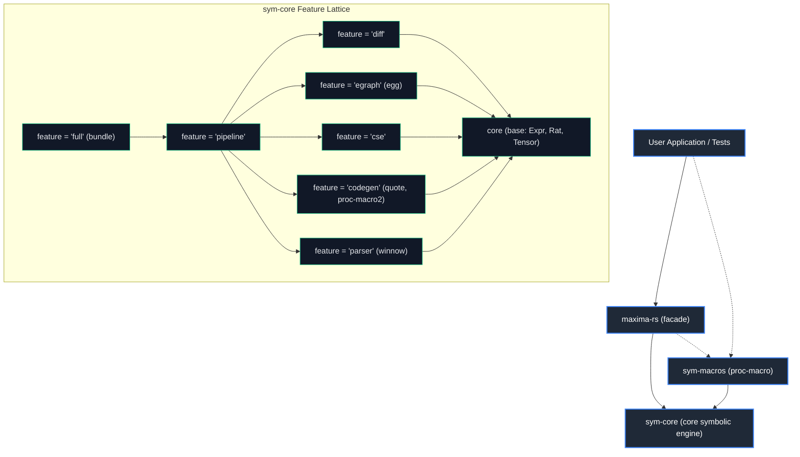
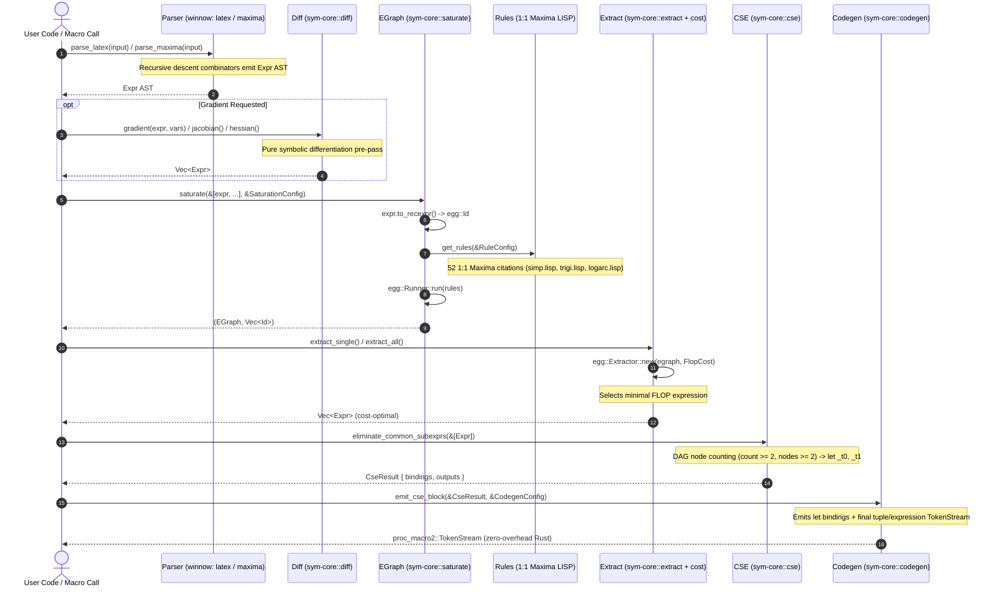
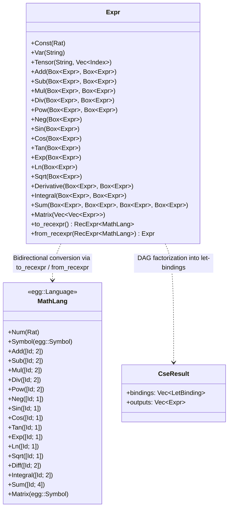

# `grafify` — Complete maxima-rs Architecture & Call Graph

This skill provides an authoritative, complete dependency and call-graph blueprint for `maxima-rs`. It traces end-to-end dataflow, crate hierarchies, module relationships, and function-level call paths.

Use this document whenever refactoring modules, adding Maxima 1:1 rules, extending parsers or AST variants, or verifying cross-module architectural seams.

---

## 1. Crate Hierarchy & Cargo Feature Coupling

---

## 2. End-to-End Pipeline Execution Call Graph

From user input (Rust macro, Maxima string, or LaTeX formula) to zero-overhead compiled Rust code:

---

## 3. Module & Function-Level Interdependency Matrix

### 3.1 `sym-core` (Library Crate)

| Module | Source File | Key Data Types | Core Functions | Direct Dependencies | Depended on by |
| :--- | :--- | :--- | :--- | :--- | :--- |
| **`expr`** | [`sym-core/src/expr.rs`](file:///e:/Rust/Max/sym-core/src/expr.rs) | `Expr` enum (16 variants), `Index` | `Expr::add`, `sub`, `mul`, `div`, `pow`, `sin`, `cos`, `tensor`, `matrix`, `derivative`, `integral`, `sum`, `eval`, `node_count`, `collect_vars` | `rational::Rat`, `tensor::Index` | All modules (`diff`, `lang`, `saturate`, `extract`, `cse`, `codegen`, `parser`, `pipeline`, `sym-macros`) |
| **`rational`** | [`sym-core/src/rational.rs`](file:///e:/Rust/Max/sym-core/src/rational.rs) | `Rat` wrapper (`BigRational`) | `Rat::from_i64`, `from_fraction`, `add`, `sub`, `mul`, `div`, `pow`, `to_f64_literal`, `to_f32_literal` | `num-rational`, `num-bigint` | `expr`, `codegen`, `lang` |
| **`tensor`** | [`sym-core/src/tensor.rs`](file:///e:/Rust/Max/sym-core/src/tensor.rs) | `Index`, `IndexType` (Covariant, Contravariant) | Constructor and indexing helpers | Core AST | `expr`, `parser::latex` |
| **`diff`** | [`sym-core/src/diff.rs`](file:///e:/Rust/Max/sym-core/src/diff.rs) | N/A (operates on `Expr`) | `differentiate(expr, var)`, `gradient(expr, vars)`, `jacobian(exprs, vars)`, `hessian(expr, vars)` | `expr::Expr` | `pipeline`, `sym-macros::expand` |
| **`lang`** | [`sym-core/src/lang.rs`](file:///e:/Rust/Max/sym-core/src/lang.rs) | `MathLang`, `MathAnalysis`, `MathData` | `Expr::to_recexpr()`, `Expr::from_recexpr()`, `MathAnalysis::make()`, `MathAnalysis::merge()` | `expr::Expr`, `rational::Rat`, `egg` | `rules/*`, `saturate`, `extract`, `cost` |
| **`provenance`**| [`sym-core/src/provenance.rs`](file:///e:/Rust/Max/sym-core/src/provenance.rs)| `RuleProvenance`, `SourcedRule`, `CitationRegistry` | `provenance_registry()`, `query_by_file()`, `format_table()` | `egg` | `rules/*` |
| **`rules`** | [`sym-core/src/rules/mod.rs`](file:///e:/Rust/Max/sym-core/src/rules/mod.rs) | `RuleConfig` | `get_rules()`, `get_sourced_rules()` | `rules::arithmetic`, `rules::trigonometric`, `rules::exponential`, `rules::logarithmic`, `provenance` | `saturate` |
| ├── `arithmetic` | [`sym-core/src/rules/arithmetic.rs`](file:///e:/Rust/Max/sym-core/src/rules/arithmetic.rs) | Rewrite definitions | `arithmetic_rules()` | `lang::MathLang`, Maxima citations (`simp.lisp`, `combin.lisp`) | `rules::mod` |
| ├── `trigonometric`| [`sym-core/src/rules/trigonometric.rs`](file:///e:/Rust/Max/sym-core/src/rules/trigonometric.rs)| Rewrite definitions | `trigonometric_rules()` | `lang::MathLang`, Maxima citations (`trigi.lisp`) | `rules::mod` |
| ├── `exponential` | [`sym-core/src/rules/exponential.rs`](file:///e:/Rust/Max/sym-core/src/rules/exponential.rs) | Rewrite definitions | `exponential_rules()` | `lang::MathLang`, Maxima citations (`logarc.lisp`, `simp.lisp`) | `rules::mod` |
| └── `logarithmic` | [`sym-core/src/rules/logarithmic.rs`](file:///e:/Rust/Max/sym-core/src/rules/logarithmic.rs) | Rewrite definitions | `logarithmic_rules()` | `lang::MathLang`, Maxima citations (`logarc.lisp`) | `rules::mod` |
| **`cost`** | [`sym-core/src/cost.rs`](file:///e:/Rust/Max/sym-core/src/cost.rs) | `FlopCost` (implements `egg::CostFunction`) | `FlopCost::cost()` | `lang::MathLang`, `egg` | `extract` |
| **`saturate`** | [`sym-core/src/saturate.rs`](file:///e:/Rust/Max/sym-core/src/saturate.rs) | `SaturationConfig` | `saturate(exprs, config)` | `lang::MathLang`, `rules::get_rules`, `egg::Runner` | `extract`, `pipeline`, `sym-macros::expand` |
| **`extract`** | [`sym-core/src/extract.rs`](file:///e:/Rust/Max/sym-core/src/extract.rs) | N/A | `extract_single(egraph, root)`, `extract_all(egraph, roots)` | `cost::FlopCost`, `lang`, `expr::Expr`, `egg::Extractor` | `pipeline`, `sym-macros::expand` |
| **`cse`** | [`sym-core/src/cse.rs`](file:///e:/Rust/Max/sym-core/src/cse.rs) | `LetBinding`, `CseResult` | `eliminate_common_subexprs(exprs)`, `count_subexprs()`, `substitute_bindings()` | `expr::Expr` | `codegen`, `pipeline`, `sym-macros::expand` |
| **`codegen`** | [`sym-core/src/codegen.rs`](file:///e:/Rust/Max/sym-core/src/codegen.rs) | `FloatType` (F64, F32), `CodegenConfig` | `emit_expr(expr, config)`, `emit_cse_block(cse, config)` | `cse::CseResult`, `expr::Expr`, `rational::Rat`, `quote`, `proc-macro2` | `pipeline`, `sym-macros::expand` |
| **`parser`** | [`sym-core/src/parser/mod.rs`](file:///e:/Rust/Max/sym-core/src/parser/mod.rs) | `ParseError` | Re-exports `parse_maxima`, `parse_latex` | `winnow = "0.7"` | `pipeline`, facade |
| ├── `maxima` | [`sym-core/src/parser/maxima.rs`](file:///e:/Rust/Max/sym-core/src/parser/maxima.rs) | Winnow combinators | `parse_maxima(input)` | `expr::Expr`, `winnow` | `parser::mod` |
| └── `latex` | [`sym-core/src/parser/latex.rs`](file:///e:/Rust/Max/sym-core/src/parser/latex.rs) | Winnow combinators | `parse_latex(input)`, `latex_expr`, `primary`, `parse_matrix`, `parse_tensor_indices` | `expr::Expr`, `tensor::Index`, `winnow` | `parser::mod` |
| **`pipeline`**| [`sym-core/src/pipeline.rs`](file:///e:/Rust/Max/sym-core/src/pipeline.rs)| `Pipeline`, `OptimizedPipeline` | `optimize()`, `optimize_gradient()`, `Pipeline::new()`, `from_latex()`, `from_maxima()`, `differentiate()`, `optimize()`, `to_rust_fn()` | `diff`, `saturate`, `extract`, `cse`, `codegen`, `parser` | Facade, User API |

---

### 3.2 `sym-macros` (Procedural Macro Crate)

| Source File | Function / Struct | Role in Call Graph | Downstream Calls |
| :--- | :--- | :--- | :--- |
| [`sym-macros/src/lib.rs`](file:///e:/Rust/Max/sym-macros/src/lib.rs) | `sym_fn!` (proc-macro) | Entry point for compile-time symbolic functions | `expand::expand_sym_fn` |
| [`sym-macros/src/lib.rs`](file:///e:/Rust/Max/sym-macros/src/lib.rs) | `sym_eval!` (proc-macro) | Entry point for inline compile-time symbolic expressions | `expand::expand_sym_eval` |
| [`sym-macros/src/parse_sym_fn.rs`](file:///e:/Rust/Max/sym-macros/src/parse_sym_fn.rs) | `SymFnDef` | `syn::parse::Parse` implementation for Rust function syntax + attributes (`expr: ...`, `gradient: [...]`) | Parses into `sym_core::expr::Expr` |
| [`sym-macros/src/parse_sym_eval.rs`](file:///e:/Rust/Max/sym-macros/src/parse_sym_eval.rs) | `SymEvalDef` | `syn::parse::Parse` implementation for inline expressions | Parses into `sym_core::expr::Expr` |
| [`sym-macros/src/config.rs`](file:///e:/Rust/Max/sym-macros/src/config.rs) | `MacroConfig` | Extracts options: `fast_math`, `float_type`, `node_limit`, `time_limit_ms` | `SaturationConfig`, `CodegenConfig` |
| [`sym-macros/src/expand.rs`](file:///e:/Rust/Max/sym-macros/src/expand.rs) | `expand_sym_fn()`, `expand_sym_eval()` | Procedural orchestrator converting AST -> Diff -> E-Graph -> Extract -> CSE -> Codegen | `diff::gradient`, `saturate::saturate`, `extract::extract_single`, `cse::eliminate_common_subexprs`, `codegen::emit_cse_block` |

---

### 3.3 `maxima-rs` (Facade Crate)

| Source File | Item | Purpose |
| :--- | :--- | :--- |
| [`maxima-rs/src/lib.rs`](file:///e:/Rust/Max/maxima-rs/src/lib.rs) | Re-exports | Transparently forwards `sym_core::*` and optional `sym_macros::{sym_fn, sym_eval}` |
| [`maxima-rs/src/prelude.rs`](file:///e:/Rust/Max/maxima-rs/src/prelude.rs) | `prelude::*` | Curated imports (`Expr`, `Rat`, `Pipeline`, `optimize`, `optimize_gradient`, `parse_latex`, `parse_maxima`, `FloatType`) |

---

## 4. Cross-Module Data Structures (`Expr` and `egg::MathLang`)

---

## 5. Maintenance & Update Checklist for Future Phases

Whenever modifying or extending the maxima-rs engine:

1. **New AST Node**:
   - Update `Expr` in [`sym-core/src/expr.rs`](file:///e:/Rust/Max/sym-core/src/expr.rs).
   - Update `MathLang` in [`sym-core/src/lang.rs`](file:///e:/Rust/Max/sym-core/src/lang.rs) (`to_recexpr`, `from_recexpr`, `MathAnalysis`).
   - Update `diff.rs`, `cse.rs`, `cost.rs`, and `codegen.rs`.
   - Update `latex.rs` and `maxima.rs` parsers if string notation exists.
2. **New Rewrite Rule (1:1 Maxima)**:
   - Identify corresponding Common Lisp routine in `References/maxima-master.zip`.
   - Add rule function and citation in [`sym-core/src/rules/`](file:///e:/Rust/Max/sym-core/src/rules/).
   - Add citation record to `RuleProvenance`.
   - Verify golden tests and automated coverage check in `tests/integration/maxima_coverage.rs`.
3. **Pipeline Invariants**:
   - Verify zero-overhead codegen via `tests/integration/macro_expansion.rs`.
   - Verify numerical equivalence via `tests/proptest/numerical_equivalence.rs`.
   - Run `cargo clippy --all-targets --all-features -- -D warnings` and `cargo fmt`.
